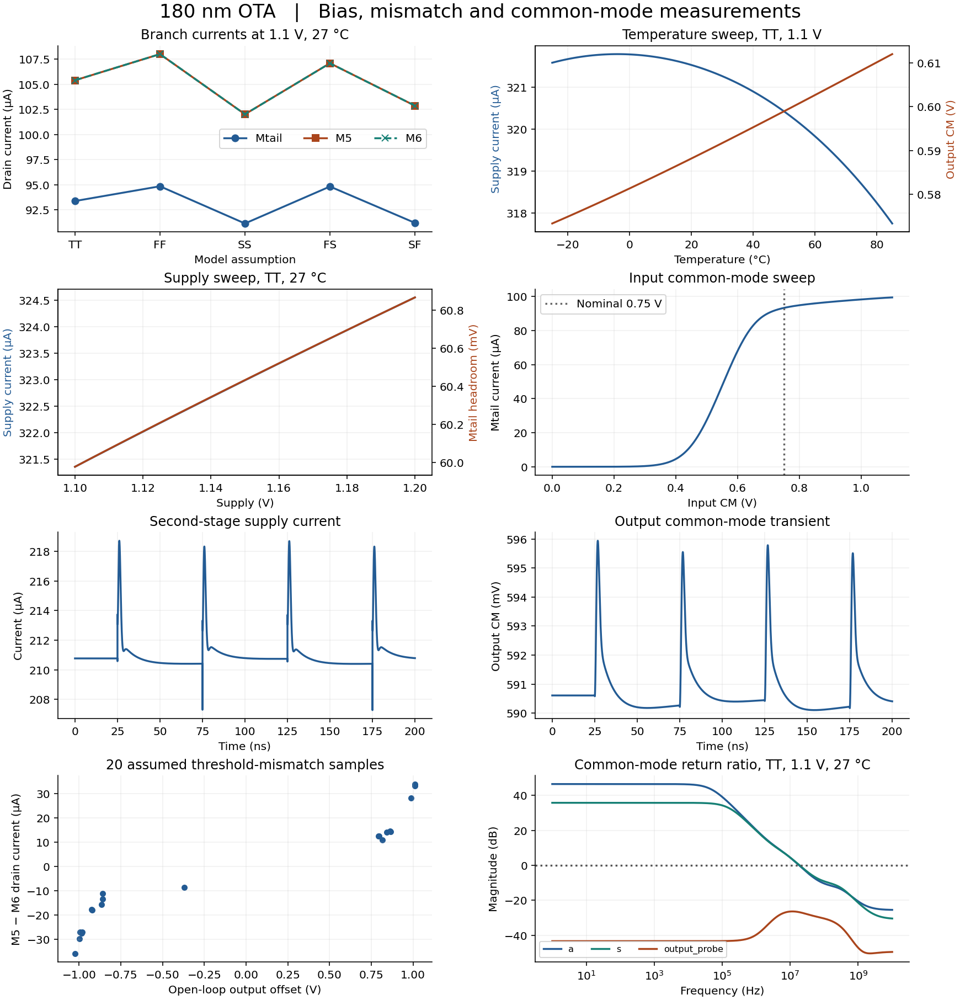

# 第三版 OTA 七项测试台复核

对象为发布版第三轮 OTA，标称条件为 180 nm、TT、1.1 V、27 °C、输入共模 0.75 V。审核中的电路连接和尺寸与 v0.1.1 相同。最差工作点出现在假设 SS、1.1 V、85 °C，Mtail 的饱和余量为 **−3.28 mV**。该条件此前测得的差模建立时间为上升 9.84 ns、下降 9.81 ns，两项测量描述不同的电路行为。

## 测试台与历史覆盖

REF 作业包的《2025 project handout2.pdf》图 1、3、4、6、9 分别给出直流、闭环 STB、阶跃、自归零和失配测试台。图 3 的探针位于放大器双输出与负载/反馈电容之间，正文设置为 differential。已检查两份原始 ZIP、内层模板、PPTX 和 PDF 附件清单，这些接线图在 PDF 中。提供的文件中没有可直接调用的 Cadence schematic/ADE cellview 或 Spectre 测试网表。这里按图在 ngspice 44.2 中搭建并测量。

| 用户列出的测试 | v0.1.1 的覆盖 | 本次补测 |
|---|---|---|
| TT、FF、SS、FS、SF | 有 30 组 PVT 差模指标，逐管工作点曾在计算中生成；发布表列总功耗与输出电平 | 40 个工作点逐管记录漏电流、VDS、VDSAT 和饱和余量，并补齐手册 II 的 10 组 −20 °C 差模仿真 |
| 温度扫描 | −25、27、85 °C 三点 | TT、1.1 V，−25 至 85 °C，每 1 °C 一点，记录电源电流与两端平均输出共模 |
| VDD 扫描 | 1.1、1.2 V 两点 | TT、27 °C，1.100 至 1.200 V，每 5 mV 一点，逐管核对电流和饱和余量 |
| 输入共模 | 用 0.1 µV 差模激励求 −3 dB 输入范围 | 沿用图 1，同步测 0 至 1.1 V、1 mV 步进的尾电流及工作点 |
| 大信号差模阶跃 | 记录差分输出与建立时间 | 在归档的图 4 闭环测试台中加入零伏电流计，记录第二级电源及对地电流、M5–M8 漏电流和双端输出，并逐点核对既有差分波形 |
| Monte Carlo | 20 个阈值扰动样本，主要记录自归零输入失调及差模性能 | 同一批种子同时测零差分输入下的开环输出失调、M5−M6 电流差，以及接入图 6 自归零反馈后的电流差和残余输出 |
| Common-mode STB | 测过差模环路、CMRR，已有 70.13° 为标称差模相位裕度 | 在图 3 输出探针位置做同相注入，并分别切开内部一级、二级的共模取样点测返回比。每个点保留另外的反馈回路，共 40 个工作点 × 3 个探针 |

## 实测结果

- **工艺、电源与温度。** 手册 I 指定 −25 °C，手册 II 指定 −20 °C，另均含 27、85 °C。五种组合 × 两种电源 × 四种温度共 40 点，零差分输入。标称 Mtail 为 93.39 µA，M5、M6 各 105.38 µA。40 点内尾电流为 88.47–94.89 µA，M5、M6 各为 98.85–109.68 µA。单独扫温时输出共模从 0.5733 V 升至 0.6121 V。单独扫 VDD 时总电流从 321.35 µA 增至 324.55 µA，10 管最小余量为 Mtail 的 +59.98 mV。[逐管工作点](pvt_dc.csv) · [−20 °C 差模补测](minus20_differential.csv)
- **尾管饱和余量。** 采用模型的 |VDS| − |VDSAT|。40 个工作点中有四处负值，均为 85 °C 的 Mtail，详见下表。其它九管在这 40 点的该项余量均为正。输入共模单扫时，尾电流在 0.443、0.750、0.927 V 分别为 10.99、93.39、97.31 µA；扫到 0.669 V 时尾管余量首次转正。此前 0.443–0.927 V 是按差模增益下降 3 dB 定义的输入范围，尾电流在此范围内变化显著。
- **大信号阶跃。** 图 4 每侧输入变化 ±31.25 mV，电容比 4，目标差分步幅 250 mV。200 ns 内第二级从 VDD 吸取 **207.28–218.72 µA**，静态 210.77 µA；输出共模 0.59010–0.59594 V，**5.84 mV 峰峰值**。供电电流含位移电流，原始数据另列 M5、M6 沟道电流之和。共模为 (Vop+Vom)/2，电流计只包围第二级器件。
- **失配。** 20 个样本使用相同的 101–120 号种子。零差分输入、开环时，Vop−Vom 的范围 −1.025 至 +1.011 V，样本标准差 0.918 V，部分输出接近电源轨；M5−M6 电流差的样本标准差 22.48 µA。加入自归零后，该电流差的标准差为 1.69 µA，输入补偿电压标准差为 2.00 mV。自归零残余输出和未补偿输出使用独立列。[失配逐样本数据](monte_carlo.csv)
- **共模稳定性。** 标称内部探针 a 的交越为 18.32 MHz、相位裕度 108.85°，s 为 19.01 MHz、113.20°。40 点最小值分别为 94.57°、98.51°。图 3 的输出端同相返回比在 1 Hz 至 10 GHz **没有 0 dB 交越**，标称峰值 −26.34 dB，40 点中最高 −14.80 dB，因此该探针的相位裕度栏留空。各内部数值均描述其余回路闭合时、该工作点和该注入位置的线性化结果。[逐工况返回比与交越](cm_loops.csv)

| 假设角 | 温度 | Mtail 余量 @ 1.1 V | Mtail 余量 @ 1.2 V |
|---|---:|---:|---:|
| SS | 85 °C | −3.28 mV | −2.40 mV |
| SF | 85 °C | −2.64 mV | −1.82 mV |

## 方法、模型与原始数据

标称使用用户提供的 BSIM3 180 nm 模型。模型文件只有 nch、pch 两张标称卡。FF/SS/FS/SF 的首字母对应 NMOS，次字母对应 PMOS，快慢分别采用迁移率 ±12%、阈值绝对值 ∓25 mV。失配仅加入独立阈值扰动，σ=3 mV·µm/√(WL)，样本标准差按 N−1 计算。这些数值用于灵敏度验证；代工厂角、带相关性的统计模型、Spectre 原生 STB 和版图后仿尚待相应模型、工具或版图。

共模 AC 分析使用每十倍频 100 点。外部探针同时、同相驱动两端并对两侧电流求和，内部探针 a、s 分别分开取样网络和受控管栅极。两次独立电压注入保持原直流工作点，求两端口导纳，计算 T=(Y12+Y21)/(Y11+Y22)。另在恢复连接的完整环路独立注入单位共模电流，所得驱动点阻抗与 1/ΣY 在全频段逐点比对（相对容差 0.1%）。模型电容及双向耦合保留；DC 偏置电感在小信号分析中取 10²⁰ H 近似开路，瞬态采用已发布测试台的等效 1 GH。

[完整原始数据、测试网表与仿真日志](https://github.com/DestinySky1/Analog_Design_Test_OPAMP/releases/download/v0.1.2/bias-review.zip) 包含以下文件。

- `pvt_dc.csv`、`temperature.csv`、`vdd.csv`、`input_cm.csv`、`monte_carlo.csv` 中电压为 V、电流为 A。逐管 `id` 沿用 ngspice BSIM3 漏电流约定，M5、M6 的直流值为正。另有 `minus20_differential.csv` 及对应的时域波形。
- `large_signal.npz` 含完整时间轴、双输出、差分与共模电压、第二级电源/地电流和各管漏电流。`cm/<工况>/<探针>.npz` 含复数返回比、四个导纳、闭环校验阻抗及频率轴。`decks/` 保留每个测试台的输入网表、模型、运行日志和原始文本测量。
- 在仓库根目录运行 `python3 sim/bias_review.py bias-review` 和 `python3 sim/bias_plots.py bias-review bias-review/observations.png` 即可复现。仿真依赖 ngspice 和 NumPy，绘图另用 Matplotlib。
